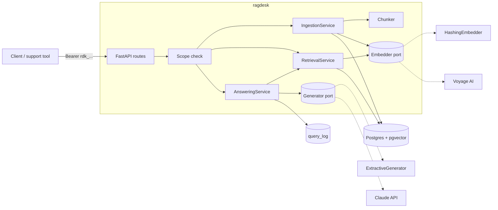
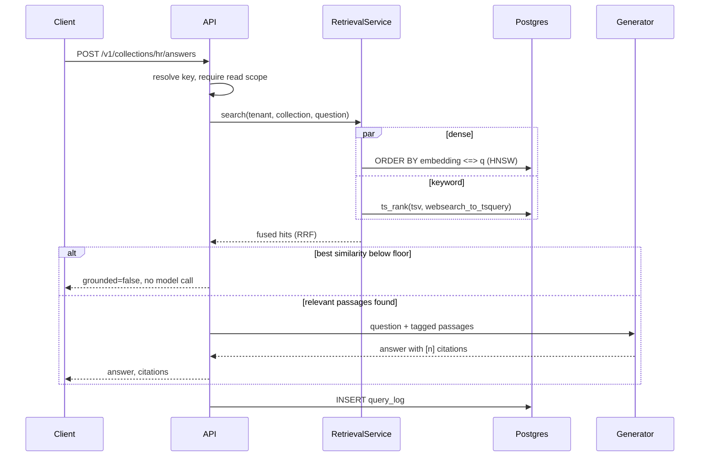
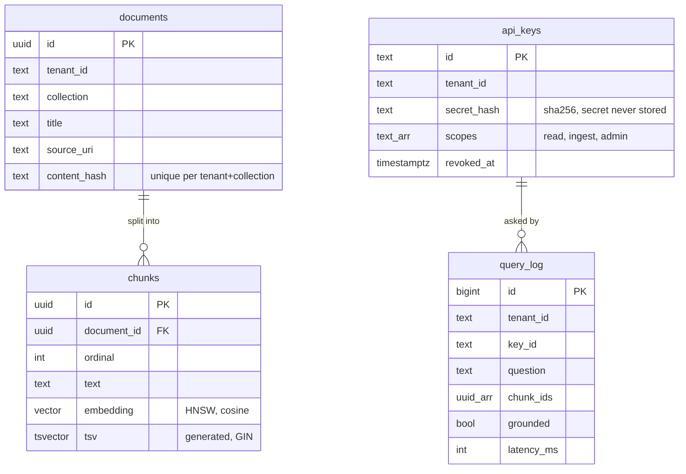

# ragdesk

[](https://github.com/jakhongirjp/ragdesk/actions/workflows/ci.yml)

A multi-tenant question-answering service over an organisation's own documents.
Teams ingest policies, runbooks and product docs into collections; employees and
support tools ask questions and get answers that **cite the passages they came
from**, or an explicit "I couldn't find this" when the documents don't say.

The design goal is an answer you can audit. Every answer carries citations,
every question is written to an audit log, and retrieval quality is measured by
an evaluation suite that runs in CI and fails the build on regression.

## Why it's built this way

| Concern | Decision |
|---|---|
| Wrong answers are worse than no answer | A relevance floor decides whether the model is called at all. Below it, the service abstains without spending a token. |
| Exact terms (error codes, SKUs, names) | Hybrid retrieval: pgvector HNSW for meaning, Postgres full-text for terms, merged with Reciprocal Rank Fusion. See [ADR 0002](docs/adr/0002-hybrid-retrieval-with-rrf.md). |
| One more database to run | Vectors live in Postgres next to the documents, so tenancy, deletes and backups are one system. See [ADR 0001](docs/adr/0001-postgres-pgvector-over-a-vector-database.md). |
| Tenants must never see each other's data | Tenant and collection come from the API key, never the request body, and every query filters on them. |
| Prompt injection from ingested documents | Passages are wrapped in `<document>` tags with escaped titles, and the system prompt treats them as data. See [ADR 0003](docs/adr/0003-grounded-generation-and-abstention.md). |
| Vendor lock-in | Embedder and generator are ports. Offline defaults (hashing embedder, extractive answers) mean the full suite runs with no API keys. |

## Architecture



The code follows a ports-and-adapters layout. `domain/` has no I/O, `services/`
depends only on the protocols in `ports.py`, and `adapters/` holds Postgres,
in-memory, embedding and generation implementations. The HTTP layer parses,
authorises, calls one service and shapes the response.

```
src/ragdesk/
  domain/        models, chunking: pure functions and value objects
  ports.py       Embedder, Generator, DocumentStore, KeyStore, QueryLog
  services/      ingestion, retrieval (RRF), answering, authz
  adapters/      postgres, memory, embeddings, generation
  api/           FastAPI app, schemas, Prometheus metrics
  migrations/    SQL, applied under an advisory lock at startup
  evaluation/    offline eval harness and a labelled dataset
  bootstrap.py   wires adapters from Settings
tests/           unit, API (in-memory) and Postgres integration tests
```

### Answering a question



### Data model



## API

All routes need `Authorization: Bearer rdk_<key_id>_<secret>`.

| Method | Path | Scope | Purpose |
|---|---|---|---|
| `POST` | `/v1/collections/{collection}/documents` | ingest | Chunk, embed and store a document. Identical content is deduplicated. |
| `DELETE` | `/v1/collections/{collection}/documents/{id}` | ingest | Remove a document and its chunks. |
| `POST` | `/v1/collections/{collection}/search` | read | Ranked passages, no generation. |
| `POST` | `/v1/collections/{collection}/answers` | read | A cited answer, or an abstention. |
| `GET` | `/healthz`, `/readyz`, `/metrics` | none | Liveness, readiness (database ping), Prometheus. |

```bash
curl -s localhost:8000/v1/collections/hr/answers \
  -H "Authorization: Bearer $RAGDESK_KEY" -H 'content-type: application/json' \
  -d '{"question": "How many days of annual leave do employees get?"}'
```

```json
{
  "answer": "Employees receive 28 days of paid annual leave per year. [1]",
  "grounded": true,
  "citations": [{"index": 1, "title": "Leave", "snippet": "Employees receive 28 days ..."}],
  "model": "extractive"
}
```

## Running it

```bash
docker compose up --build
docker compose exec api ragdesk-admin create-key --tenant acme --name local --scopes read,ingest
```

The key is printed once. To have Claude write the answers instead of the
extractive generator, set `RAGDESK_GENERATOR=claude` and `ANTHROPIC_API_KEY`.

For development:

```bash
python -m venv .venv && . .venv/bin/activate
pip install -e ".[dev]"
pytest                      # Postgres tests skip unless RAGDESK_TEST_DATABASE_URL is set
ruff check . && mypy
ragdesk-eval                # retrieval quality report
```

### Configuration

| Variable | Default | Notes |
|---|---|---|
| `RAGDESK_STORE` | `postgres` | `memory` for local experiments only |
| `RAGDESK_DATABASE_URL` | none | required for `postgres` |
| `RAGDESK_EMBEDDER` | `hashing` | `voyage` needs `RAGDESK_VOYAGE_API_KEY` |
| `RAGDESK_EMBEDDING_DIMENSIONS` | `384` | fixed at first migration |
| `RAGDESK_GENERATOR` | `extractive` | `claude` needs `ANTHROPIC_API_KEY` |
| `RAGDESK_CLAUDE_MODEL` | `claude-opus-5-5` | |
| `RAGDESK_MIN_SIMILARITY` | `0.15` | abstention floor; tune with `ragdesk-eval` |

## Evaluation

`ragdesk-eval` ingests a small labelled corpus and asks 22 questions, 3 of them
deliberately unanswerable. It reports recall@k, MRR and the abstention rate, and
exits non-zero below the thresholds, which is how CI gates on it.

Current baseline with the offline hashing embedder at k=5: recall 1.00, MRR
0.947, abstention 0.667. The abstention number is the one to improve: one
unanswerable question still clears the similarity floor. That is tracked as an
issue rather than hidden by lowering the threshold.

## Security

- API keys are `rdk_<id>_<secret>`. Only a SHA-256 of the secret is stored and
  comparison is constant-time. Keys can be revoked with `ragdesk-admin revoke-key`.
- Scopes are checked in the service layer, so a new route can't forget them.
- Tenant isolation is enforced in every store query and covered by tests for
  both the memory and Postgres adapters.
- Inputs are bounded: documents up to 2 million characters, questions up to 2000 characters.
- The audit log records who asked what and which chunks were used, not the answer text.

## Documentation

| Document | Contents |
|---|---|
| [Product](docs/product.md) | Vision, business problem, business and technical requirements, workflows |
| [Engineering](docs/engineering.md) | Boundaries, security, performance, observability, DR, DevOps, testing |
| [Roadmap](docs/roadmap.md) | Ten milestones and the release plan |
| [CTO review checklist](docs/cto-review-checklist.md) | Honest status against production-readiness criteria |
| [ADRs](docs/adr) | Architecture decisions |
| [Contributing](CONTRIBUTING.md) | Branching, commits, labels, board, releases |

## License

MIT
