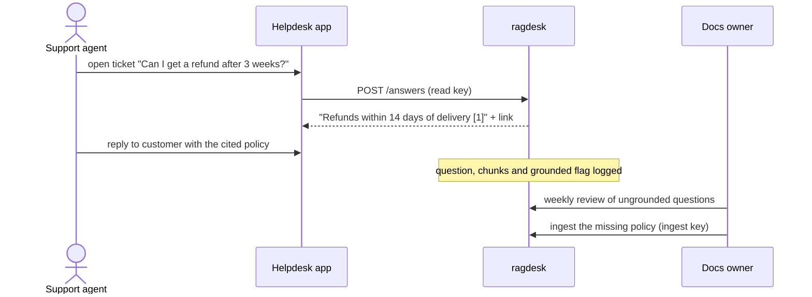

# Product: vision and requirements

## Vision

Answers about how a company works (refund limits, on-call rules, leave
policy, product limits) are scattered across wikis and PDFs, and people ask the
same questions in chat every day. ragdesk lets any team load its documents and
get answers that quote and link the source, and that say plainly when the
documents don't cover the question. It is built for companies that need to
prove where an answer came from.

**Who it's for.** Support teams answering customers, internal help desks
(HR, IT, finance), and product teams embedding Q&A in their own tools through
the API.

## Business problem

| Today | Cost |
|---|---|
| Agents search the wiki for each ticket | Minutes per ticket, inconsistent answers |
| Generic chatbots | Confident answers that the policy doesn't support; legal exposure |
| Copying documents into a third-party chat tool | Data handling and residency issues; no tenant separation |
| No record of what was asked | No way to see what the documentation is missing |

## Business requirements

| ID | Requirement |
|---|---|
| BR-1 | Every answer cites the passages it is based on. |
| BR-2 | When the documents don't answer the question, say so instead of guessing. |
| BR-3 | Each customer (tenant) sees only its own documents. |
| BR-4 | Keys can be limited to reading or to ingesting, and revoked. |
| BR-5 | Every question is logged with who asked and which passages were used. |
| BR-6 | Answer quality is measured, and a regression blocks a release. |
| BR-7 | The service can run without any external AI provider. |

## Technical requirements

| ID | Requirement | How it is met |
|---|---|---|
| TR-1 | Retrieval handles both paraphrase and exact terms | Hybrid pgvector + full-text search fused with RRF (ADR 0002) |
| TR-2 | Abstention | Similarity floor checked before generation (ADR 0003) |
| TR-3 | Isolation | Tenant from the API key; every store query filters on tenant and collection |
| TR-4 | Pluggable providers | `Embedder` and `Generator` ports; hashing/extractive offline, Voyage/Claude online |
| TR-5 | Idempotent ingestion | Content hash unique per tenant and collection |
| TR-6 | Measured quality | `ragdesk-eval`: recall@k, MRR, abstention; CI gate |
| TR-7 | Latency | p95 under 300 ms for `/search` and under 4 s for `/answers` with Claude (targets, M5) |

## Out of scope (for now)

Document connectors (Confluence, Google Drive) are M6; PDF and HTML parsing is
M3; a chat UI is left to the products that embed the API.

## Business workflow: support agent answers a ticket

